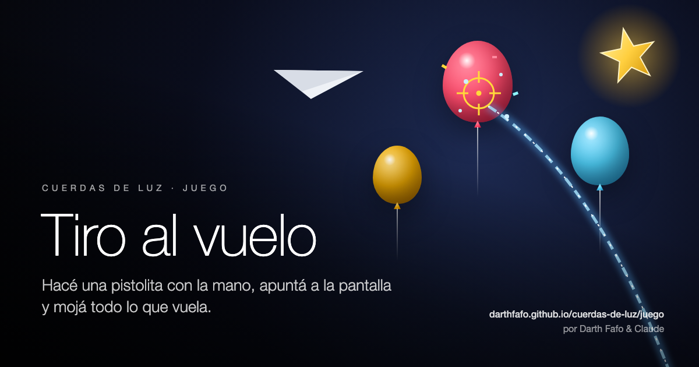
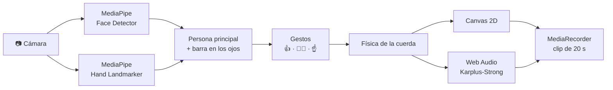

<p align="center">
  <a href="https://darthfafo.github.io/cuerdas-de-luz/"></a>
</p>

<h1 align="center">Cuerdas de luz</h1>

<p align="center">
  <b>Un instrumento de cuerdas invisible.</b> Las tendés en el aire con las manos y las tocás con el dedo.<br>
  Solo necesitás la cámara de la compu y un navegador.
</p>

<p align="center">
  <a href="https://darthfafo.github.io/cuerdas-de-luz/"><b>▶&nbsp; Probalo acá</b></a>
</p>

---

## ¿Qué onda?

Abrís la página, la cámara te reconoce las manos (21 puntos por mano, en tiempo real) y con eso armás tu propio instrumento: cada cuerda la estirás vos, del largo y con el ángulo que quieras. Cuando la cruzás con el dedo, vibra, tira chispas y suena como una cuerda de verdad. Las largas suenan graves y las cortas agudas, y todas las notas caen en una escala pentatónica, así que cuesta que suene mal.

No se instala nada, no hay que crear cuenta y no hay servidor: todo pasa en tu navegador.

## Cómo se toca

| Gesto | Qué hace |
|---|---|
| 👍 Pulgar arriba con la mano **derecha** | Arranca. Hasta que lo hacés, la cámara se ve desenfocada |
| 🤏🤏 **Juntar las dos pinzas** (pulgar + índice de cada mano) **1 segundo** | Se carga un anillo y nace una cuerda en ese punto. Separá las manos para estirarla |
| ✋ Soltar cualquiera de las dos pinzas | La cuerda queda fija en el aire |
| ☝️ Pasar el índice a través de una cuerda, **a su misma distancia de la cámara** | La tocás. Más rápido, más fuerte; más lejos, más bajito |
| ✊ ✊ Los dos puños cerrados 2 segundos | Se borran todas las cuerdas (un anillo te muestra la carga) |
| 🖱️ Arrastrar / pasar por encima | Lo mismo con el mouse, o con el dedo en el celu |

> ¿El 👍 no te sale? Tocá **Empezar sin gesto** o apretá `Enter`. ¿No tenés cámara? Está **Usar sin cámara**.

### El espacio es 3D

Cada cuerda vive a una distancia real de la cámara. Si estirás una con una mano cerca y la otra lejos, queda inclinada hacia el fondo.

- **Lo cercano** se ve grueso y brillante; **lo lejano**, fino y tenue. Las marcas de la regla son cada 2 cm de verdad, así que se juntan a lo lejos.
- **El largo real define la nota**, también el largo que se va hacia el fondo.
- **Tu mano tapa** las cuerdas que le quedan atrás.
- Para tocar una cuerda hay que estar a su profundidad, con unos 12 cm de margen. Si el dedo pasa por delante o por detrás, un cartel te dice cuánto acercarlo o alejarlo.
- Con el mouse o el dedo se trabaja siempre a 60 cm.

### En el celu

- **Alcanza con una mano**, porque la otra suele estar sosteniendo el teléfono: hacé la pinza, dejala quieta 1 segundo hasta que se cargue el anillo, arrastrá y soltá. Si lo apoyás en algún lado, también funciona con las dos.
- El 👍 vale **con cualquier mano**.
- **Con el dedo en la pantalla**: arrastrá para crear una cuerda y deslizá a través de ella para tocarla. Anda con varios dedos a la vez y, en Android, vibra cuando tocás.
- **Suena aunque el iPhone esté en silencio** (Safari 16.4 o más nuevo).
- La pantalla **no se apaga** mientras tocás en el aire.
- **Instalala como app**: en el menú del navegador elegí *Agregar a pantalla de inicio* y se abre a pantalla completa, con su ícono.

### Botones y teclas

| Botón | Tecla | Qué hace |
|---|:---:|---|
| ● Grabar clip | `R` | Graba 20 segundos con imagen y sonido |
| Ocultar ojos | `O` | Te pone una barra negra sobre los ojos (también sale en el clip) |
| Vista 3D | `D` | Muestra el espacio desde otro ángulo (arrastrá para girarlo) |
| | `P` | Prende y apaga la profundidad (apagada, se toca desde cualquier distancia) |
| Deshacer | `Z` | Borra la última cuerda |
| Limpiar | `C` | Borra todas las cuerdas |
| 🔊 | `M` | Prende y apaga el sonido |
| ? | `?` | Muestra la ayuda |
| | `S` | Cambia la escala: pentatónica → menor → cromática → libre |
| | `H` / `V` | Muestra u oculta el esqueleto de las manos / el video |

## Grabá un clip y compartilo

Tocá **Grabar clip**: tenés una cuenta regresiva de 3 segundos para acomodar las manos, y después graba **20 segundos** (o hasta que lo frenes) con la imagen y el sonido. Al terminar te muestra el clip para **descargarlo** o, en el celu, **compartirlo** directo.

- Sale en **MP4** si tu navegador lo soporta (Chrome, Edge y Safari recientes) y si no, en **WebM**.
- Lleva una marca de agua chiquita con el nombre y el link.
- Los botones no salen en el video. La barra de **Ocultar ojos** sí, así que podés compartirlo tranqui.

## 🥚 Easter egg

<details>
<summary>Hay algo escondido. Abrí esto solo si te rendís.</summary>

<br>

Hacé una **pistolita** con la mano (índice estirado, pulgar para arriba y los otros dedos cerrados) y **sostenela quieta 2 segundos**. Aparece una pistola de agua 3D o, si tenés suerte, una de fantasía que tira agua arcoíris. Gira en perspectiva con tu mano, incluso si apuntás hacia la cámara. Para disparar, **cerrá el índice** como si apretaras el gatillo de una pistola de verdad (el gatillo del modelo se mueve con tu dedo y la pistola sigue apuntando derecho). Si el chorro pega en una cuerda, la hace sonar. Para guardarla, abrí la mano.

Por dentro: MediaPipe también da los puntos de la mano en 3D, y con eso se calcula hacia dónde apunta el índice y hacia dónde mira la palma. La pistola se arma con piezas de [three.js](https://threejs.org) (cápsulas, cilindros, un toro), que se baja recién cuando empezás a hacer el gesto. Se dibuja en perspectiva solo en un cuadrado alrededor de la mano, y si el navegador no tiene WebGL queda una versión 2D.

Y cuando la encontrás, aparece un botón para ir a **Tiro al vuelo**, el juego de la pistola (más abajo).

</details>

## 🎯 Tiro al vuelo, el juego de la pistola

<p align="center">
  <a href="https://darthfafo.github.io/cuerdas-de-luz/juego/"></a>
</p>

Una variante aparte, solo con la pistola de agua: **[darthfafo.github.io/cuerdas-de-luz/juego](https://darthfafo.github.io/cuerdas-de-luz/juego/)**

1. Hacé la **pistolita** con la mano y sostenela un momento: aparece la pistola.
2. **Apuntá a la pantalla**, como con una pistola de luz. La mira va adonde apunta el caño.
3. **Cerrá el índice** frente al globo del centro: ese primer disparo calibra la mira y arranca la partida.
4. Tenés **60 segundos** para mojar todo lo que vuela antes de que se escape, sobre la imagen de tu cámara y en 3D.

| Blanco | Puntos | |
|---|---:|---|
| 🎈 Globo | 100 | Sube flotando; con un chorrito revienta |
| ✈️ Avión de papel | 150 | Cruza la pantalla y, mojado, se viene abajo girando |
| ⭐ Estrella dorada | 500 | Aparece poco, va rápido y en zigzag |

- **Combo:** cada 3 aciertos seguidos el multiplicador sube (hasta ×5). Si se te escapa uno, vuelve a ×1.
- **Agua:** el tanque se vacía mientras disparás y se recarga solo cuando soltás el gatillo. El agua del tanque de la pistola 3D baja de verdad.
- **Si el chorro no pega en nada**, las gotas quedan en el "vidrio" de la pantalla y chorrean.
- **Sin cámara:** tocá *Jugar con el mouse* (o *con el dedo* en el celu).
- **Teclas:** `+` / `-` cambian la sensibilidad de la mira, `M` el sonido.
- El récord se guarda en tu navegador.

**Cómo apunta:** con los puntos 3D de la mano se calcula la dirección del caño. Si apuntás derecho a la cámara la mira queda en el centro, y si girás la muñeca se mueve, como un puntero láser. Como cada uno se para distinto, el primer disparo al globo del centro calibra la mira. Además hay una ayuda de puntería: los blancos se pueden acertar desde un poco más lejos de lo que parece, porque el tracking de un dedo que apunta a la cámara nunca es perfecto.

## Privacidad

- El video de la cámara **nunca sale de tu compu**. No hay servidor, ni cuentas, ni cookies, ni analytics.
- Lo único que se baja de internet son los modelos de detección de MediaPipe y, para la pistola y el juego, three.js (desde jsDelivr y Google).
- El récord del juego se guarda solo en tu navegador.
- Los clips se arman en tu navegador y solo existen si los descargás.
- La página tiene una *Content Security Policy*: solo puede ejecutar código de este sitio y de jsDelivr.

## Cómo funciona por dentro



**1. Ver las manos.** [MediaPipe Hand Landmarker](https://ai.google.dev/edge/mediapipe/solutions/vision/hand_landmarker) encuentra 21 puntos en cada mano, unas 30 veces por segundo. Corre en la placa de video (WebGL + WebAssembly) y, si no puede, en el procesador. Además mide cuánto tarda cada detección y se adapta: en una compu rápida analiza todos los cuadros, y en un celu más lento los espacia para que el tracking nunca use más de la mitad del tiempo y la animación siga fluida.

**2. Quedarse con una sola persona.** Busca hasta 4 manos pero usa dos: las de la persona con la cara más grande, o sea la que está más cerca de la cámara. Descarta las manos lejanas o de gente que pasa por atrás, y asigna una a la izquierda y otra a la derecha para que cada mano mantenga su lugar.

**3. Entender los gestos.**
- *Pinza*: compara la distancia entre pulgar e índice con el tamaño de la mano, así funciona igual cerca o lejos de la cámara. Se cierra al 28 % y se abre recién al 45 % (histéresis), para que no titile.
- *Crear una cuerda*: las dos pinzas tienen que tocarse y sostenerse 1 segundo, así no aparecen cuerdas sin querer. Si se pierde una mano de vista mientras estirás, se la espera un momento y, si no vuelve, la cuerda se cancela.
- *Pulgar arriba*: el pulgar tiene que estar estirado, apuntando para arriba y más alto que los otros dedos, que tienen que estar cerrados. Hay que sostenerlo poco más de medio segundo.
- *Tocar*: entre un cuadro y el siguiente, la punta del índice traza un segmento. Si ese segmento cruza una cuerda, la tocaste. La velocidad del dedo define la fuerza.

**4. Medir la profundidad con una sola cámara.** Una mano se ve más grande cuanto más cerca está, pero medir solo su tamaño engaña: si la inclinás, se achica sin alejarse. Por eso se buscan los píxeles por metro que mejor hacen coincidir los 21 puntos en pantalla con los 21 puntos 3D que da MediaPipe. Sobre un video de prueba, los saltos de la medida (percentil 95) bajaron del 30 % al 14 %, y después se suaviza. La distancia es aproximada, porque supone una cámara web común y una mano promedio, pero el espacio es coherente: alcanza para estirar y tocar.

**5. La cuerda vibra de verdad (bueno, casi).** Cada cuerda es la suma de sus primeros 6 modos de vibración (los armónicos), cada uno con su frecuencia y su amortiguación. El punto donde la tocás define qué armónicos se excitan, como en una guitarra: cerca de la punta suena más brillante y en el medio más redondo.

**6. El sonido.** Síntesis [Karplus-Strong](https://es.wikipedia.org/wiki/Algoritmo_de_Karplus-Strong): un buffer cortito de ruido que se recircula promediándose consigo mismo. Ese promedio funciona como un filtro, y lo que queda suena a cuerda pulsada. El largo del buffer define la nota (cuerda larga, en centímetros reales = nota grave), que se ajusta a la escala elegida y pasa por un eco suave y un compresor.

**7. La grabación.** Un lienzo aparte copia cada cuadro a 1280 px y le suma la marca de agua. `MediaRecorder` lo junta con la salida de audio y arma el video.

## Correrlo en tu compu

No hay nada que compilar. Alcanza con cualquier servidor estático:

```bash
git clone https://github.com/darthfafo/cuerdas-de-luz.git
cd cuerdas-de-luz
python3 -m http.server 8766
```

Después abrí <http://localhost:8766>. La cámara solo anda en `localhost` o con `https://`.

> **Para desarrollar sin webcam:** en localhost podés usar un video en lugar de la cámara con `http://localhost:8766/?video=mi-clip.mp4`.

```
index.html             la página de las cuerdas, los metadatos y la Content Security Policy
style.css              estilos (compartidos con el juego)
app.js                 las cuerdas: tracking, gestos, física, sonido, grabación y el easter egg
juego/                 Tiro al vuelo: página, estilos y juego.js (blancos 3D, puntería, puntaje)
lib/camera.js          abrir la cámara, errores, mapeo a la pantalla
lib/vision.js          cargar los modelos de MediaPipe
lib/gestures.js        gestos (pulgar arriba, pistolita, gatillo) y la pose 3D de la mano
lib/space.js           el espacio 3D: profundidad de la mano, perspectiva, vista 3D y contorno de la mano
lib/gun3d.js           la pistola de agua en 3D (three.js) y los reflejos
manifest.webmanifest   para instalarla como app en el celu
assets/                íconos e imágenes para compartir en redes
```

## Navegadores

Anda mejor en **Chrome o Edge en la compu**. También debería andar en Safari y Firefox recientes (en Firefox los clips salen en WebM). En el celu funciona en Chrome (Android) y Safari (iPhone): baja un poco la carga del tracking y se adapta a la potencia del teléfono, pero en equipos viejos puede ir más lento.

## Créditos

Desarrollado por **[Darth Fafo](https://github.com/darthfafo)** y **Claude** (Anthropic), a puro ida y vuelta.

La detección de manos y caras es de [MediaPipe](https://ai.google.dev/edge/mediapipe), de Google (licencia Apache 2.0).

## Licencia

[MIT](LICENSE): usalo, modificalo y compartilo como quieras, siempre que mantengas el aviso de copyright.
