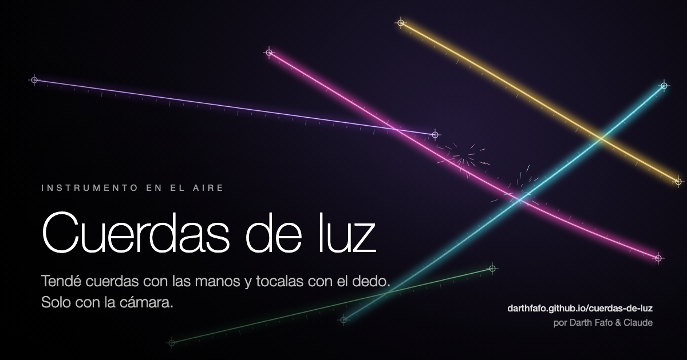
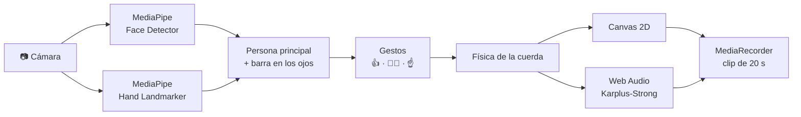

<p align="center">
  <a href="https://darthfafo.github.io/cuerdas-de-luz/"></a>
</p>

<h1 align="center">Cuerdas de luz</h1>

<p align="center">
  <b>Un instrumento de cuerdas invisible.</b> Las tendés en el aire con las manos y las tocás con el dedo.<br>
  Solo necesitás la cámara de la compu y un navegador.
</p>

<p align="center">
  <a href="https://darthfafo.github.io/cuerdas-de-luz/"><b>▶&nbsp; Probalo acá</b></a>
</p>

---

## ¿Qué onda?

Abrís la página, la cámara te reconoce las manos (21 puntos por mano, en tiempo real) y con eso armás tu propio instrumento: cada cuerda la estirás vos, del largo y con el ángulo que quieras. Cuando la cruzás con el dedo, vibra, tira chispas y suena como una cuerda de verdad. Las largas suenan graves y las cortas agudas, y todas las notas caen en una escala pentatónica, así que cuesta que suene mal.

No se instala nada, no hay que crear cuenta y no hay servidor: todo pasa en tu navegador.

## Cómo se toca

| Gesto | Qué hace |
|---|---|
| 👍 Pulgar arriba con la mano **derecha** | Arranca. Hasta que lo hacés, la cámara se ve desenfocada |
| 🤏 🤏 Pinza (pulgar + índice) con **las dos manos** | Aparece una cuerda entre las dos pinzas. Estirala como quieras |
| ✋ Soltar cualquiera de las dos pinzas | La cuerda queda fija en el aire |
| ☝️ Pasar el índice a través de una cuerda | La tocás. Más rápido, más fuerte |
| 🖱️ Arrastrar / pasar por encima | Lo mismo con el mouse, o con el dedo en el celu |

> ¿El 👍 no te sale? Tocá **Empezar sin gesto** o apretá `Enter`. ¿No tenés cámara? Está **Usar sin cámara**.

### En el celu

- **Alcanza con una mano**, porque la otra suele estar sosteniendo el teléfono: hacé la pinza, arrastrá y soltá. Si lo apoyás en algún lado, también funciona con las dos.
- El 👍 vale **con cualquier mano**.
- **Con el dedo en la pantalla**: arrastrá para crear una cuerda y deslizá a través de ella para tocarla. Anda con varios dedos a la vez y, en Android, vibra cuando tocás.
- **Suena aunque el iPhone esté en silencio** (Safari 16.4 o más nuevo).
- La pantalla **no se apaga** mientras tocás en el aire.
- **Instalala como app**: en el menú del navegador elegí *Agregar a pantalla de inicio* y se abre a pantalla completa, con su ícono.

### Botones y teclas

| Botón | Tecla | Qué hace |
|---|:---:|---|
| ● Grabar clip | `R` | Graba 20 segundos con imagen y sonido |
| Ocultar ojos | `O` | Te pone una barra negra sobre los ojos (también sale en el clip) |
| Deshacer | `Z` | Borra la última cuerda |
| Limpiar | `C` | Borra todas las cuerdas |
| 🔊 | `M` | Prende y apaga el sonido |
| ? | `?` | Muestra la ayuda |
| | `S` | Cambia la escala: pentatónica → menor → cromática → libre |
| | `H` / `V` | Muestra u oculta el esqueleto de las manos / el video |

## Grabá un clip y compartilo

Tocá **Grabar clip**: tenés una cuenta regresiva de 3 segundos para acomodar las manos, y después graba **20 segundos** (o hasta que lo frenes) con la imagen y el sonido. Al terminar te muestra el clip para **descargarlo** o, en el celu, **compartirlo** directo.

- Sale en **MP4** si tu navegador lo soporta (Chrome, Edge y Safari recientes) y si no, en **WebM**.
- Lleva una marca de agua chiquita con el nombre y el link.
- Los botones no salen en el video. La barra de **Ocultar ojos** sí, así que podés compartirlo tranqui.

## Privacidad

- El video de la cámara **nunca sale de tu compu**. No hay servidor, ni cuentas, ni cookies, ni analytics.
- Lo único que se baja de internet son los modelos de detección de MediaPipe (desde jsDelivr y Google).
- Los clips se arman en tu navegador y solo existen si los descargás.
- La página tiene una *Content Security Policy*: solo puede ejecutar código de este sitio y de jsDelivr.

## Cómo funciona por dentro



**1. Ver las manos.** [MediaPipe Hand Landmarker](https://ai.google.dev/edge/mediapipe/solutions/vision/hand_landmarker) encuentra 21 puntos en cada mano, unas 30 veces por segundo. Corre en la placa de video (WebGL + WebAssembly) y, si no puede, en el procesador. Además mide cuánto tarda cada detección y se adapta: en una compu rápida analiza todos los cuadros, y en un celu más lento los espacia para que el tracking nunca use más de la mitad del tiempo y la animación siga fluida.

**2. Quedarse con una sola persona.** Busca hasta 4 manos pero usa dos: las de la persona con la cara más grande, o sea la que está más cerca de la cámara. Descarta las manos lejanas o de gente que pasa por atrás, y asigna una a la izquierda y otra a la derecha para que cada mano mantenga su lugar.

**3. Entender los gestos.**
- *Pinza*: compara la distancia entre pulgar e índice con el tamaño de la mano, así funciona igual cerca o lejos de la cámara. Se cierra al 28 % y se abre recién al 45 % (histéresis), para que no titile.
- *Pulgar arriba*: el pulgar tiene que estar estirado, apuntando para arriba y más alto que los otros dedos, que tienen que estar cerrados. Hay que sostenerlo poco más de medio segundo.
- *Tocar*: entre un cuadro y el siguiente, la punta del índice traza un segmento. Si ese segmento cruza una cuerda, la tocaste. La velocidad del dedo define la fuerza.

**4. La cuerda vibra de verdad (bueno, casi).** Cada cuerda es la suma de sus primeros 6 modos de vibración (los armónicos), cada uno con su frecuencia y su amortiguación. El punto donde la tocás define qué armónicos se excitan, como en una guitarra: cerca de la punta suena más brillante y en el medio más redondo.

**5. El sonido.** Síntesis [Karplus-Strong](https://es.wikipedia.org/wiki/Algoritmo_de_Karplus-Strong): un buffer cortito de ruido que se recircula promediándose consigo mismo. Ese promedio funciona como un filtro, y lo que queda suena a cuerda pulsada. El largo del buffer define la nota (cuerda larga = nota grave), que se ajusta a la escala elegida y pasa por un eco suave y un compresor.

**6. La grabación.** Un lienzo aparte copia cada cuadro a 1280 px y le suma la marca de agua. `MediaRecorder` lo junta con la salida de audio y arma el video.

## Correrlo en tu compu

No hay nada que compilar. Alcanza con cualquier servidor estático:

```bash
git clone https://github.com/darthfafo/cuerdas-de-luz.git
cd cuerdas-de-luz
python3 -m http.server 8766
```

Después abrí <http://localhost:8766>. La cámara solo anda en `localhost` o con `https://`.

> **Para desarrollar sin webcam:** en localhost podés usar un video en lugar de la cámara con `http://localhost:8766/?video=mi-clip.mp4`.

```
index.html             la página, los metadatos y la Content Security Policy
style.css              estilos
app.js                 todo lo demás: tracking, gestos, física, sonido y grabación
manifest.webmanifest   para instalarla como app en el celu
assets/                íconos e imagen para compartir en redes
```

## Navegadores

Anda mejor en **Chrome o Edge en la compu**. También debería andar en Safari y Firefox recientes (en Firefox los clips salen en WebM). En el celu funciona en Chrome (Android) y Safari (iPhone): baja un poco la carga del tracking y se adapta a la potencia del teléfono, pero en equipos viejos puede ir más lento.

## Créditos

Desarrollado por **[Darth Fafo](https://github.com/darthfafo)** y **Claude** (Anthropic), a puro ida y vuelta.

La detección de manos y caras es de [MediaPipe](https://ai.google.dev/edge/mediapipe), de Google (licencia Apache 2.0).

## Licencia

[MIT](LICENSE): usalo, modificalo y compartilo como quieras, siempre que mantengas el aviso de copyright.
